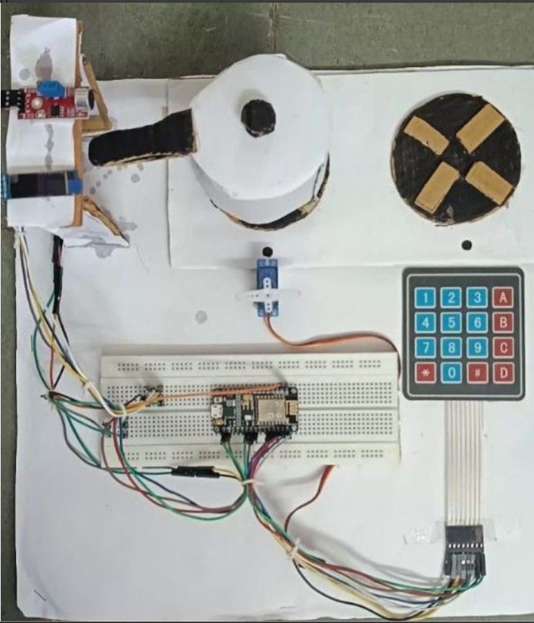

# SmartCook Solutions
### Automatic Whistle Counting Pressure Cooker

An embedded hardware-based project designed to automatically detect and count pressure cooker whistles, helping users monitor cooking progress and achieve consistent cooking results.

## Project Overview

SmartCook Solutions aims to improve traditional pressure cooking through an automatic whistle-counting mechanism.

The system is designed to detect cooker whistles using an appropriate sensing mechanism and maintain a count of detected whistles.

## Problem Statement

Manual whistle counting can be inconvenient and may lead to inconsistent cooking results. This project explores a hardware-based solution to automate whistle monitoring.

## Objectives

- Automatically detect pressure cooker whistles.
- Count detected whistles.
- Reduce the need for manual monitoring.
- Improve cooking convenience and consistency.

## Hardware Components

The actual component list will be documented after verifying the hardware used in the prototype.

## Working Principle

1. The sensing unit monitors the pressure cooker.
2. The system detects a whistle event.
3. The controller processes the sensor signal.
4. The whistle count is updated.
5. The count can be displayed or communicated through the implemented output system.

## Project Architecture

Sensor → Microcontroller → Processing → Whistle Count → Output

## Applications

- Smart kitchen appliances
- Cooking automation
- Embedded systems
- Sensor-based monitoring

## Project Status

Hardware implementation and technical details will be documented with actual prototype photographs and circuit information.

## Founder

Golla Obula Narasimha

## Acknowledgement

Developed as a project under the Ignite India initiative.

---
**Note:** This repository documents the SmartCook Solutions project. Hardware specifications, source code and test results will be added based on the actual implementation.
## Project Gallery

### SmartCook Solutions – Hardware Project

